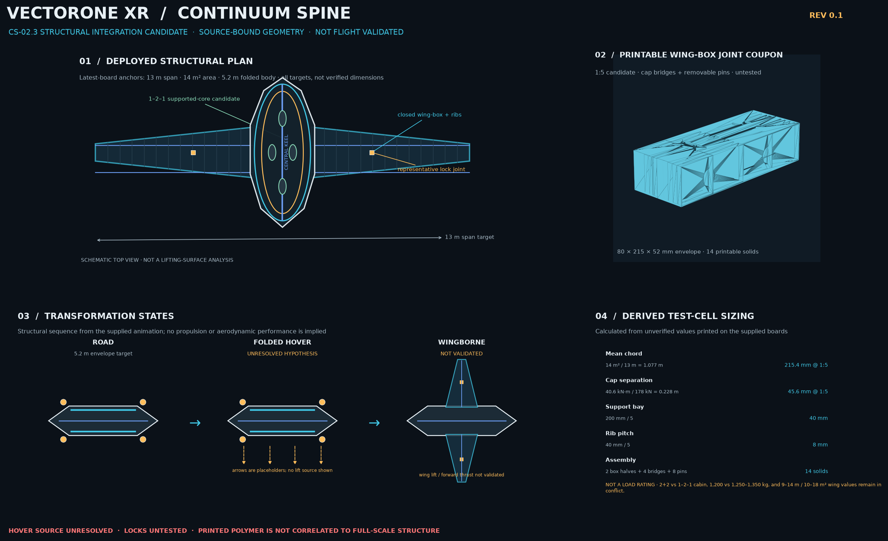

# VectorOne XR source artifact release

This release contains 50 original files from Fuad Ashraf’s VectorOne XR engineering research archive: 39 CAD exchange/mesh files, six Python scripts, one Lean source file, two JSON metric records, one design-basis document, and one original engineering board image. The files are organized by type; original filenames retain their archive record IDs.

## What this shows

- A concept-stage road/flight vehicle structure study and its versioned geometry.
- Parametric and first-principles Python modeling, drawing/rendering scripts, and a small Lean model.
- CAD assemblies and components for the body, wing-box, locks, pins, wheel interfaces, and hinge coupons.
- JSON records that retain their own model/version context.

## Research and engineering status

This is a preliminary design and software artifact release. The source board labels the geometry as source-bound and not flight validated. The local research workboard says the occupant/configuration versions and mass, shaft-power, hover-power, and mission-energy budgets remain unresolved. The repository therefore does **not** establish flight capability, aerodynamic performance, structural safety, a rated load, a validated propulsion system, fabrication readiness, or regulatory compliance. The CAD should not be treated as manufacturing instructions or as safe for construction or operation.

The board is included as an original image from the research archive. Its own caveats remain visible; it is not an independent test report.

## Reproducibility and provenance

The 50 listed artifacts were copied from the original archive without editing. `SHA256SUMS.txt` records their hashes for integrity checking. One additional renderer file was deliberately omitted from this public selection because its source contains a workstation-specific local path. No proposal PDFs, patent records, private correspondence, credentials, or identity documents are part of this package.

The parent project repository also contains the related research-stage proposal at [`research/vectorone-xr-research-proposal.pdf`](../vectorone-xr-research-proposal.pdf).

## Reuse

Copyright remains with the author. No permission for manufacture, commercial use, or redistribution is granted by this portfolio release. Ask the author for permission before reusing the design files.
