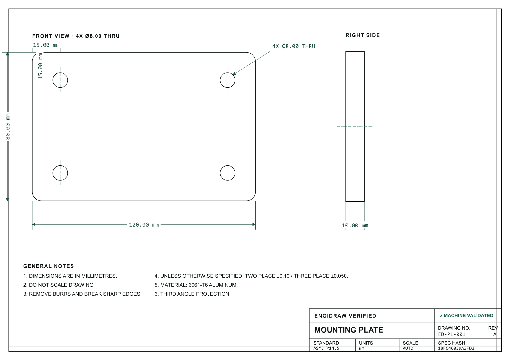

# EngiDraw Verified

EngiDraw Verified is a working MVP for deterministic engineering-document and computational-geometry generation.

It does not use a text-to-image model to draw authoritative geometry. Structured specifications feed deterministic geometry functions, validators, renderers, and evidence manifests.

## Current capabilities

- Dimensioned mechanical SVG drawings for plates, flanges, and three-step shafts
- ASME Y14.5 and ISO 128 profile selection recorded in every artifact
- Constrained natural-language interpretation for the supported templates
- Validation gates for physical dimensions, profile containment, spacing, metadata, and template boundaries
- SHA-256 input and artifact fingerprints
- SVG, JSON evidence manifest, print/PDF workflow, and canonical-spec download/copy
- Implicit signed-distance gyroid thermal-core generation
- Marching-tetrahedra surface extraction, rotatable 3D preview, STL export, CEM recipe, and mesh telemetry
- Explicit separation between machine-validated drawings and research geometry that still requires physics/manufacturing validation

## Run locally

Requirements: Node.js 22.13 or newer.

```bash
npm install
npm run dev
```

Open the local URL shown by the development server.

## Verify

```bash
npm test
npm run build
npm run lint
```

## Project structure

- `app/page.tsx` — interactive engineering workbench
- `lib/engidraw.ts` — typed mechanical specifications, validators, SVG renderer, interpreter, artifact manifests
- `lib/computational.ts` — implicit gyroid SDF, meshing, STL generation, mesh rendering, computational evidence
- `tests/engine.test.ts` — deterministic and rejection-path tests
- `examples/` — supported example specifications
- `artifacts/ED-PL-001_REV-A.svg` — the original SVG drawing exported from the running application on November 20, 2026
- `artifacts/ED-PL-001_REV-A.png` — a high-resolution PNG preview rendered from that SVG for viewing and sharing
- `docs/computational-engineering-architecture.md` — path from MVP to LEAP 71-class computational engineering

## Exported sample drawing

The included mounting-plate SVG shows the default 120 × 80 × 10 mm plate, four 8 mm holes, 15 mm offsets, R5 corners, and the selected 6061-T6 aluminum material. The running interface reported 11 machine checks passed, zero failed, and zero warnings. These checks cover drawing parameters and template boundaries only. The drawing is not engineer-approved or qualified for manufacture.



## Accuracy boundary

“Validated” means the checks in the downloaded manifest passed. It does not certify fitness, safety, code compliance, manufacturability, or physical performance. Production release requires domain-specific simulation, process validation, physical testing, and qualified engineer approval.

## License note

This repository does not bundle ASME, ISO, IEC, or other licensed standards content. A production implementation must license the applicable documents and obtain legal review before making conformance claims.
