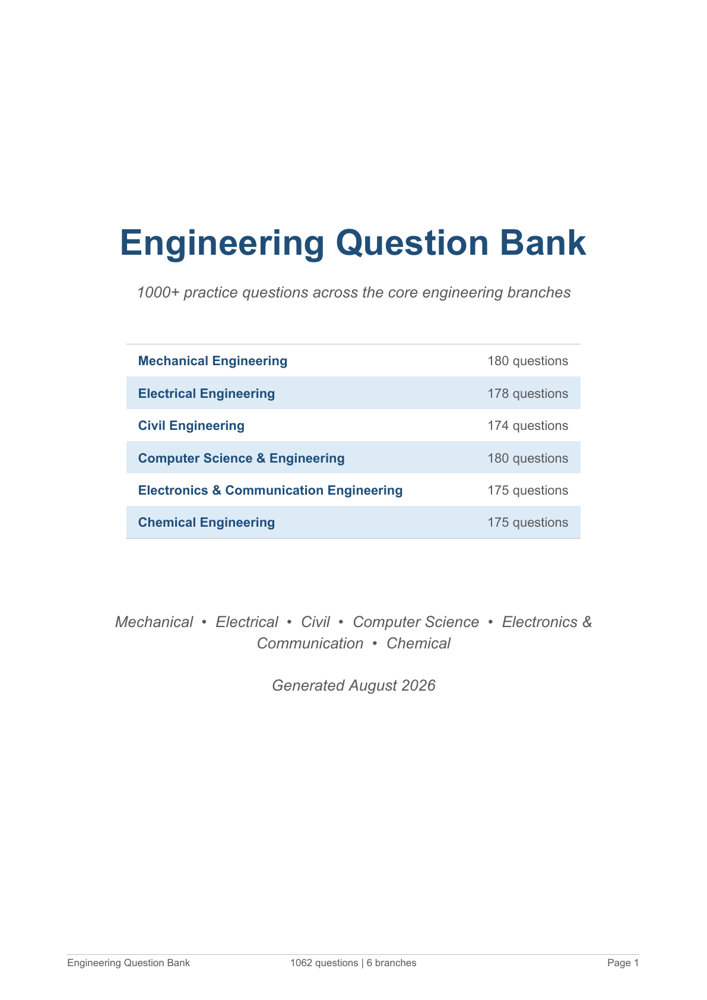

# Engineering Question Generator

An original Python project for generating structured engineering practice questions from parameterized templates. The source builds questions with formulas, computed answers, solution steps, topic tags, and input parameters, then exports JSONL and CSV.



## Included files

- `source/` — the original Python modules, original data card, and original source archive.
- `data/engineering_questions.csv` — the original 100,000-row CSV output, preserved byte-for-byte.
- `data/engineering_questions.jsonl.gz` — a compressed JSONL export regenerated from the source. It includes the parameter values needed for record-by-record verification.
- `outputs/Engineering_Question_Bank_1062.pdf` and `.xlsx` — a separate, static presentation bank of 1,062 questions across six branches. It is distinct from the 100,000-record generated dataset.
- `media/Engineering_Question_Bank_Cover.png` — the cover rendered from the original PDF.

The generator covers 166 templates, 10 engineering branches, and 57 topics. Its questions are synthetic computational practice material; they are not an expert-reviewed exam bank or a substitute for engineering review.

## Generate a dataset

From this project directory, run from a separate output folder so generated files do not mix with the source:

```text
mkdir build-output
cd build-output
python ../source/generate.py 100000
```

The generator writes `engineering_questions.jsonl` and `engineering_questions.csv` to the current directory, using its default random seed of `12345`.

## Verify

NumPy is needed by some numeric cross-checks; see `requirements-validation.txt`.

```text
python source/anchors.py
python source/verify.py
```

To verify the included JSONL, decompress `data/engineering_questions.jsonl.gz` and run:

```text
python source/verify_dataset.py path/to/engineering_questions.jsonl
```

## Verification recorded for this release

- 33 of 33 hand-computed anchor values passed.
- All 166 templates loaded; 576 template-level numeric cross-checks passed.
- The regenerated JSONL contained 100,000 unique questions; all 100,000 stored answers were re-derived successfully.
- All 28,014 record-level numeric cross-checks passed.

See [`PROVENANCE.md`](PROVENANCE.md) for how the original CSV compares with the regenerated verification export and for the distinction between the two question-bank outputs.
